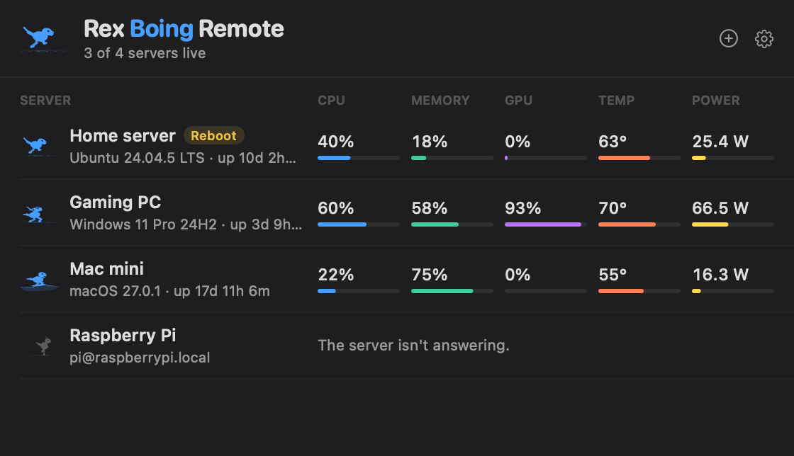
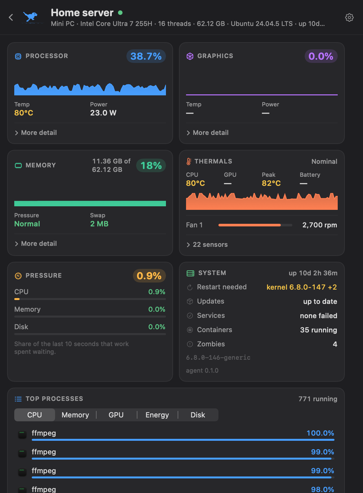
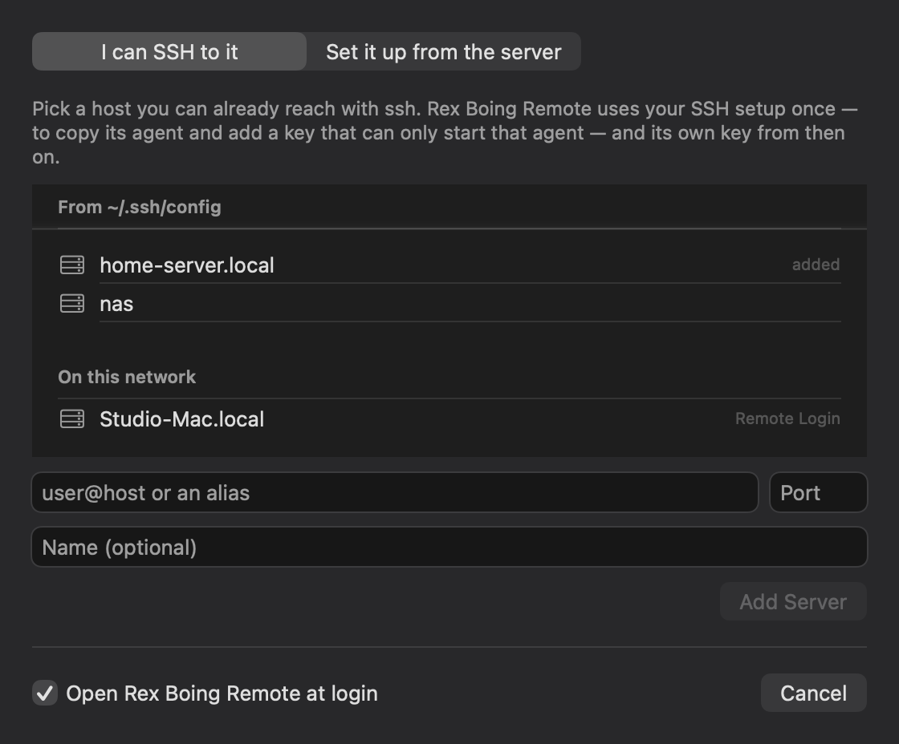
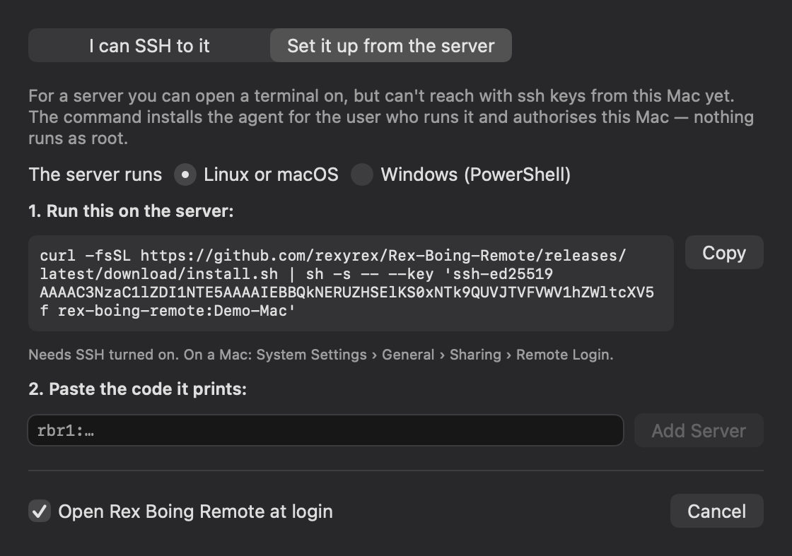
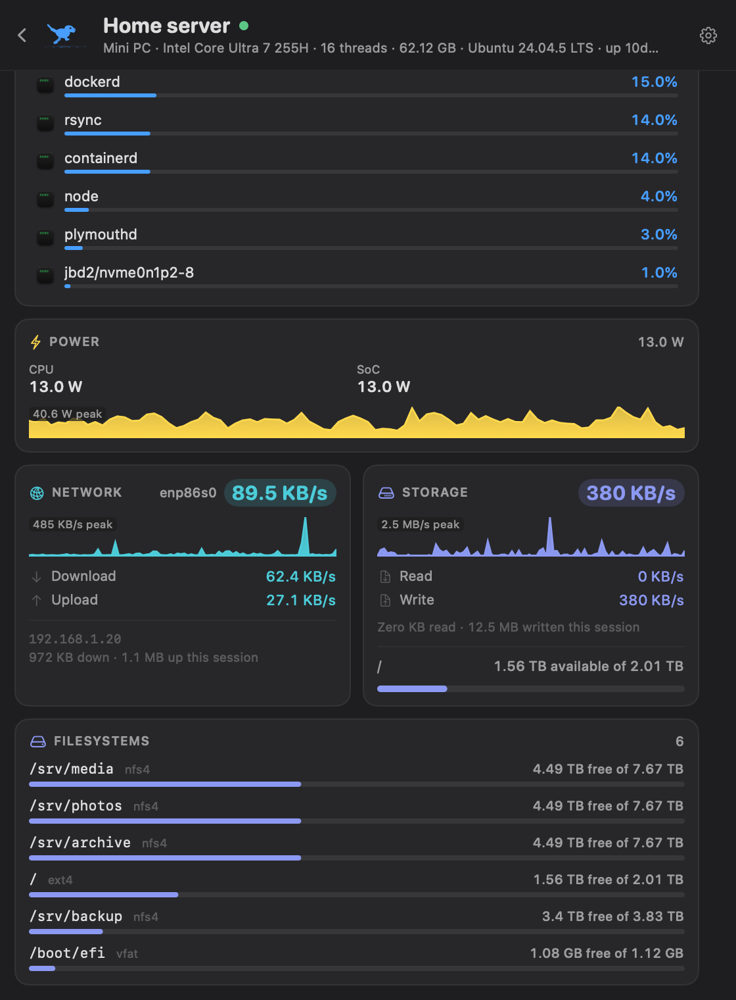

# Rex Boing Remote

Your servers in the Mac menu bar, each with its own running rex.

<p align="center"></p>

<table>
  <tr>
    <td width="50%" valign="top"></td>
    <td width="50%" valign="top"></td>
  </tr>
</table>

<sub>The pictures come from the app's own views in demo mode: the servers are made up, the interface is real. See <a href="CONTRIBUTING.md#demo-mode-no-servers-needed">CONTRIBUTING.md</a>.</sub>

Rex Boing Remote watches Linux, macOS and Windows machines over the SSH you
already use, and shows them with the cards and characters of
[Rex Boing](https://github.com/rexyrex/Rex-Boing): CPU per core, GPU engines,
memory and swap, every temperature sensor and fan, power, pressure stall,
network, disks and filesystems, the top processes, and whether a server needs
a reboot or has failed services.

- **Nothing to open on the server.** No port, no web server, no daemon. The
  app starts a small agent over SSH while it watches, and the agent exits
  when the session ends.
- **History while you're away, if you want it.** Turn on *Keep history while
  this Mac is away* for a server, and the agent keeps sampling there as a
  service of your user (still no port, no root), so the dashboard shows what
  happened overnight: 48 hours of vitals and the busiest processes.
- **No root.** The agent runs as the user you log in as. It can only read.
- **Reconnects by itself.** After your Mac sleeps, after either side reboots,
  after Wi-Fi or a VPN changes.
- **Works with your SSH setup.** Aliases, jump hosts, `ProxyCommand`,
  1Password and Secretive agents, hardware keys: if `ssh myserver` works in
  Terminal, it works here.

macOS 14 or later on the Mac. Servers: Linux (x86-64, ARM64, ARMv6/7 —
Raspberry Pi included), macOS 14+, Windows 10/11 and Server 2019+.

## Install

```bash
brew install --cask rexyrex/tap/rex-boing-remote
```

Or download `Rex.Boing.Remote.zip` from the
[latest release](https://github.com/rexyrex/Rex-Boing-Remote/releases/latest),
unzip it and move it to Applications. It is signed and notarized.

## Add a server

Open the app; the Add Server window comes up on its own the first time.

<table>
  <tr>
    <td width="50%" valign="top"></td>
    <td width="50%" valign="top"></td>
  </tr>
</table>

**If you can already `ssh` to it**, pick it from the list (your
`~/.ssh/config` hosts and the machines on your network that accept SSH) or
type `user@host`, and press Add. Any password, one-time code or new host key
is asked for in a dialog, once. The app copies the agent over, and adds its
own key to the server's `authorized_keys`, restricted so it can only ever
start the agent. Every later connection uses that key, so reconnecting never
needs you, your SSH agent or your hardware key again.

**If you can't ssh to it from this Mac yet**, choose *Set it up from the
server*. The app shows one command, with your Mac's key already in it. Run it
on the server:

```bash
curl -fsSL https://github.com/rexyrex/Rex-Boing-Remote/releases/latest/download/install.sh \
  | sh -s -- --key 'ssh-ed25519 AAAA… rex-boing-remote:Your-Mac'
```

or, on Windows, in PowerShell:

```powershell
& ([scriptblock]::Create((irm https://github.com/rexyrex/Rex-Boing-Remote/releases/latest/download/install.ps1))) -Key 'ssh-ed25519 AAAA… rex-boing-remote:Your-Mac'
```

It prints a pairing code (`rbr1:…`). Paste it into the app. The code carries
the server's addresses and its SSH host keys, so the first connection is
already verified, and if the server has several addresses (home network,
Tailscale, public), the app finds whichever one answers.

SSH has to be on: install `openssh-server` on Linux; turn on *Remote Login*
on a Mac (System Settings › General › Sharing); add *OpenSSH Server* on
Windows (Settings › System › Optional features).

## Using it

- The **fleet rex** stands for all your servers and runs at the busiest one's
  CPU. Its caption says how many are live.
- **Pin** a server (Settings › Servers) to give it a rex of its own, with a
  readout of your choice beside it. The first server you add is pinned.
- Click a rex for the fleet list; click a server for its dashboard.
- A server that drops off falls asleep in the menu bar, and its row says why
  and when the next try is. *Retry Now* skips the wait.

## History while your Mac is away

Each dashboard has a **History** card: the last 15 minutes, 4 hours or 48
hours of CPU, memory, temperature, power, network and disk. Point at a moment
to see the readings then and the busiest processes of that quarter hour.

On its own, the app can only record while it is connected. To fill the gaps
when your Mac sleeps or leaves home, turn on **Keep history while this Mac is
away** for a server in Settings › Servers. The app then asks the agent to run
in the background on that server, as your user:

| Server | Runs as |
|---|---|
| Linux | a systemd user service. Your services only keep running after you log out if *lingering* is on; the app says if it isn't, with the one command that turns it on (`sudo loginctl enable-linger <you>`). |
| macOS | a LaunchAgent, started again at every login. |
| Windows | a Scheduled Task, started when you sign in, running while you are signed in. |

It samples every 2 seconds, keeps 48 hours (in its own folder, so it survives
restarts), opens no port, and talks only to a socket only your user can reach.
On reconnect, the agent sends what it kept and the graphs fill in. Turning the
setting off removes the service and the history it kept.

## What each kind of server reports

<p align="center"></p>

| | Linux | macOS | Windows |
|---|---|---|---|
| CPU per core, load, processes | ✓ | ✓ | ✓ (no load average) |
| GPU busy, engines, memory | Intel, AMD, NVIDIA | Apple | any vendor (engines); NVIDIA temperature, power, fan |
| Temperatures, fans | hwmon, thermal zones | every SMC sensor | thermal zones; more with LibreHardwareMonitor |
| CPU power | RAPL, after one `udev` rule | ✓ | via LibreHardwareMonitor |
| Pressure stall | ✓ | memory pressure | — |
| Reboot needed, updates, failed services, containers | ✓ | — | reboot needed |

Run `~/.local/share/rex-boing-remote/rex-boing-agent doctor` on a server to see
what it can read and how to unlock the rest.

## How it works

```
Mac: Rex Boing Remote ──ssh (your route: LAN, VPN, jump host, tunnel)──▶ server: rex-boing-agent
                      ◀── one JSON line per sample ──
                      ── what's on screen ──▶
```

The agent is one static file in `~/.local/share/rex-boing-remote/` (Windows:
`%LOCALAPPDATA%\RexBoingRemote\`). It samples only what the screen shows: a
few hundred bytes every couple of seconds for the menu bar, everything once a
second while you look at that server's dashboard. The format is documented in
[PROTOCOL.md](PROTOCOL.md), so anyone can write an agent for another system.

The Linux and Windows agents are Go. The macOS agent is Rex Boing's own
sampling code, built headless, which is also why the dashboard cards look the
same as Rex Boing's: they are the same code, shared through the
`RexBoingKit` package in the Rex Boing repository.

## Security and privacy

- The app talks only to the servers you add. No telemetry, no analytics, no
  update checks.
- The key the app installs is restricted on the server with `restrict` and a
  forced command: it cannot open a shell, forward ports or run anything but the
  agent.
- Host keys are never accepted silently: a new one is shown for you to
  confirm, and a changed one stops the connection.
- The agent removes passwords and tokens from command lines before they leave
  the server.
- Release files are checksummed, and the checksums signed with the project's
  key ([docs/allowed_signers](docs/allowed_signers)); the installers check both.

See [SECURITY.md](SECURITY.md) for the details and how to report a problem.

## Removing a server

Settings › Servers › select it › **−**. Leave *Also remove the agent* on and
the app asks the agent to delete itself and its key; nothing else on the
server is touched. On the server itself, `install.sh --uninstall` (or
`install.ps1 -Uninstall`) does the same.

## Building from source

Needs Xcode 26 or later, [XcodeGen](https://github.com/yonaskolb/XcodeGen) and Go 1.24 or later.

```bash
Scripts/build.sh            # agents and app, into dist/
Scripts/build.sh --install  # and into /Applications
cd agent && go test ./...   # the Go agent's tests
```

To work on Rex Boing's shared code at the same time, point the build at your
checkout: `REX_BOING_PATH=../Rex-Boing Scripts/build.sh`. No servers to try it
on? `open "dist/Rex Boing Remote.app" --args --demo` starts it with made-up
ones. See [CONTRIBUTING.md](CONTRIBUTING.md).

## License

MIT. See [LICENSE](LICENSE).
